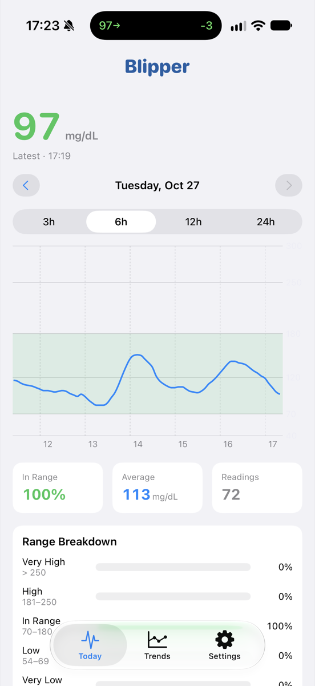

# Blipper

A native SwiftUI iPhone app that shows your continuous glucose monitor (CGM) data from [Tidepool](https://www.tidepool.org).

> ## ⚠️ Not for treatment decisions
>
> **Blipper is an informational viewer only. It is not a medical device and has not been reviewed or cleared by any regulator.**
>
> Do not use it to make insulin dosing, food, or other treatment decisions. Always rely on your CGM receiver, pump, or clinician for that. Data may be delayed, incomplete, or displayed incorrectly.

## Screenshots

| Today | Trends | Settings | Device detail |
| :---: | :---: | :---: | :---: |
|  |  |  |  |

## Features

**Today** – a glucose timeline for any day, with a shaded 70–180 mg/dL target band.
- Tap or drag on the chart to scrub; the header shows the selected reading and time.
- Switch between 3 h, 6 h, 12 h, and 24 h windows and step between days.
- Summary tiles for time in range, average, and reading count, plus a five-band breakdown (very low, low, in range, high, very high).
- Auto-refreshes every 5 minutes, with pull-to-refresh.

**Trends** – 7, 14, 30, or 90 day reports.
- Time in range with change versus the previous period.
- Average, standard deviation, coefficient of variation, and glucose management indicator (GMI).
- Ambulatory glucose profile (AGP) with median and 25–75 / 5–95 percentile bands.
- Daily stacked range bars.

**Settings** – your Tidepool account, devices that uploaded in the last 30 days with their latest pump and CGM settings, target thresholds, and app info.

## Requirements

- Xcode 27 or later
- iOS 17.0 or later
- A Tidepool account with CGM data

## Getting started

1. Open `Blipper.xcodeproj` in Xcode.
2. Select your own development team under *Signing & Capabilities*. The app uses a Keychain access group entitlement, so it must be built signed.
3. Run on a simulator or device and sign in with your Tidepool email and password.

Your credentials are stored in the device Keychain and sent only to `api.tidepool.org` to fetch your data. They are never written to logs or sent anywhere else.

### Developing without an account

Two launch arguments are available in Debug builds (set them in the scheme's *Arguments Passed On Launch*):

| Argument | Effect |
| --- | --- |
| `-useMockData` | Skips login and uses a deterministic mock CGM trace. |
| `-initialTab today\|trends\|settings` | Opens on the given tab. |

## Architecture

- `Models/` – `GlucoseReading`, range classification and statistics, AGP and daily aggregation, device and settings models.
- `Data/` – a protocol-based data layer. `GlucoseDataProvider` and `DeviceInfoProvider` have both a mock implementation and a Tidepool one built on `TidepoolClient`. `CredentialStore` wraps the Keychain.
- `Views/` – SwiftUI views using Swift Charts.
- View models are `@Observable` and `@MainActor`; the data layer is `nonisolated` and `Sendable`.

Diagnostic logging uses OSLog (subsystem `com.PickleTron.Blipper`) and records counts and field names only, never glucose values or account details.

## License

[MIT](LICENSE)
