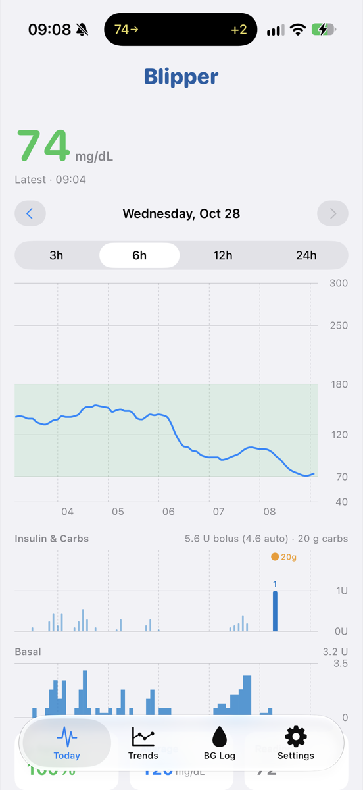
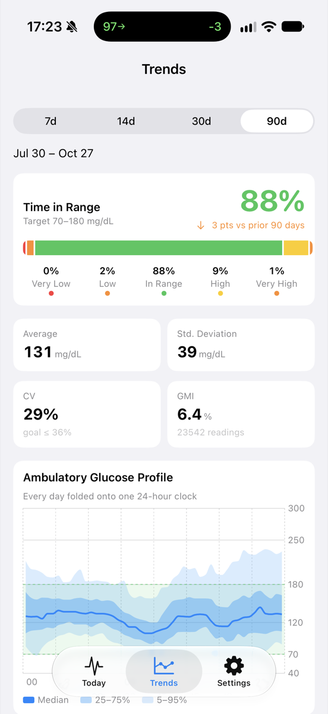
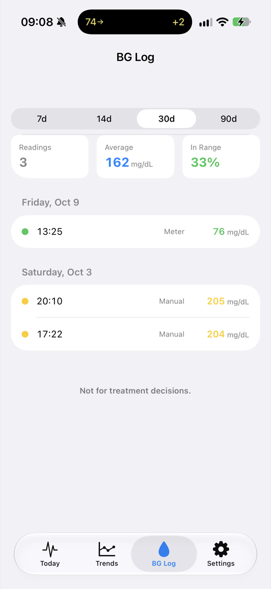
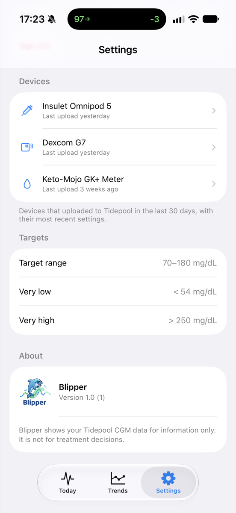
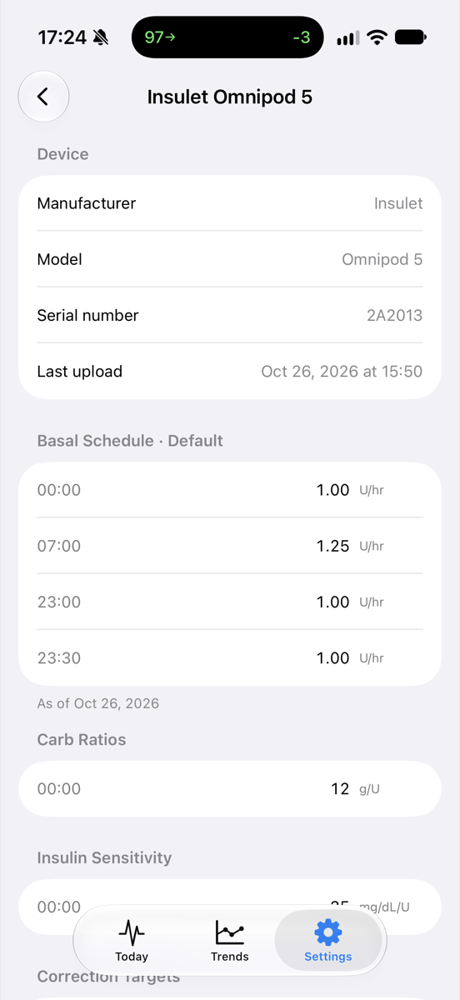

# Blipper

A native SwiftUI iPhone app that shows your continuous glucose monitor (CGM) data from [Tidepool](https://www.tidepool.org).

> ## ⚠️ Not for treatment decisions
>
> **Blipper is an informational viewer only. It is not a medical device and has not been reviewed or cleared by any regulator.**
>
> Do not use it to make insulin dosing, food, or other treatment decisions. Always rely on your CGM receiver, pump, or clinician for that. Data may be delayed, incomplete, or displayed incorrectly.

## Screenshots

| Today | Trends | BG Log | Settings | Device detail |
| :---: | :---: | :---: | :---: | :---: |
|  |  |  |  |  |

## Features

**Today** – a glucose timeline for any day, with a shaded 70–180 mg/dL target band.
- Tap or drag on the chart to scrub; the header shows the selected reading and time.
- Switch between 3 h, 6 h, 12 h, and 24 h windows and step between days.
- Insulin and carbs under the glucose chart: boluses as bars (closed-loop automatic boluses as thin ticks), carb entries along the top, and basal rate as a step chart colored by scheduled, temp, automated, or suspended.
- Fingerstick readings appear as hollow dots on the glucose chart; scrubbing shows the basal rate in effect and any nearby bolus, carbs, or fingerstick.
- Summary tiles for time in range, average, and reading count, bolus, basal, and carb totals, plus a five-band breakdown (very low, low, in range, high, very high).
- Auto-refreshes every 5 minutes, with pull-to-refresh.

**BG Log** – blood glucose meter (fingerstick) readings for the last 7, 14, 30, or 90 days, grouped by day with count, average, and in-range summary.

**Trends** – 7, 14, 30, or 90 day reports.
- Time in range with change versus the previous period.
- Average, standard deviation, coefficient of variation, and glucose management indicator (GMI).
- Ambulatory glucose profile (AGP) with median and 25–75 / 5–95 percentile bands.
- Daily stacked range bars.

**Settings** – your Tidepool account, devices that uploaded in the last 30 days with their latest pump and CGM settings, target thresholds, and app info.

**Sharing** (under Settings) – the same share flow as the Share page in Tidepool Web.
- Share with a clinic: enter the 12-digit share code, confirm the clinic name that comes back, choose whether the clinic may upload, and send the invite.
- Share with a care team member by email, with the same upload choice.
- See who is sharing and which invites are still pending, allow or remove upload permission, resend a care team invite, revoke an invite, remove a member, or leave a clinic.

**Data Connections** (under Settings) – the cloud-to-cloud connections Tidepool supports: Dexcom, twiist, and FreeStyle Libre (LibreView).
- Each provider shows its logo and connection status with the same wording as Tidepool Web: connected with the time of the last data, awaiting data, error, or not connected.
- Connect or Reconnect asks Tidepool for a one-time authorization link and opens the provider's own sign-in in an in-app Safari sheet. Tidepool completes the OAuth exchange on its side; when the sheet closes, the status refreshes.
- Disconnect revokes Tidepool's authorization with the provider. FreeStyle Libre also needs to be disconnected in the LibreView app, and the screen says so.

## Requirements

- Xcode 27 or later
- iOS 17.0 or later
- A Tidepool account with CGM data

## Getting started

1. Open `Blipper.xcodeproj` in Xcode.
2. Select your own development team under *Signing & Capabilities*. The app uses a Keychain access group entitlement, so it must be built signed.
3. Run on a simulator or device and sign in with your Tidepool email and password.

Your credentials are stored in the device Keychain and sent only to `api.tidepool.org` to fetch your data and to manage sharing and data connections. They are never written to logs or sent anywhere else. Connecting a data provider opens that provider's sign-in page in an in-app Safari view; Blipper never sees those credentials.

### Developing without an account

Two launch arguments are available in Debug builds (set them in the scheme's *Arguments Passed On Launch*):

| Argument | Effect |
| --- | --- |
| `-useMockData` | Skips login and uses a deterministic mock CGM trace. |
| `-initialTab today\|trends\|log\|settings` | Opens on the given tab. |
| `-openSharing` | Starts on the Sharing screen (use with `-initialTab settings`). |
| `-openShareInvite` | Also presents the share invite form. |
| `-openDataConnections` | Starts on the Data Connections screen (use with `-initialTab settings`). |

## Architecture

- `Models/` – `GlucoseReading`, range classification and statistics, AGP and daily aggregation, device and settings models.
- `Data/` – a protocol-based data layer. `GlucoseDataProvider`, `TherapyDataProvider` (bolus, basal, wizard, food, and smbg records), `DeviceInfoProvider`, `ShareProvider` (clinic and care team sharing), and `DataConnectionProvider` (Dexcom, twiist, and LibreView links) each have a mock implementation and a Tidepool one built on `TidepoolClient`. `CredentialStore` wraps the Keychain.
- `Views/` – SwiftUI views using Swift Charts.
- View models are `@Observable` and `@MainActor`; the data layer is `nonisolated` and `Sendable`.

Diagnostic logging uses OSLog (subsystem `com.PickleTron.Blipper`) and records counts and field names only, never glucose values or account details.

## License

[MIT](LICENSE)
